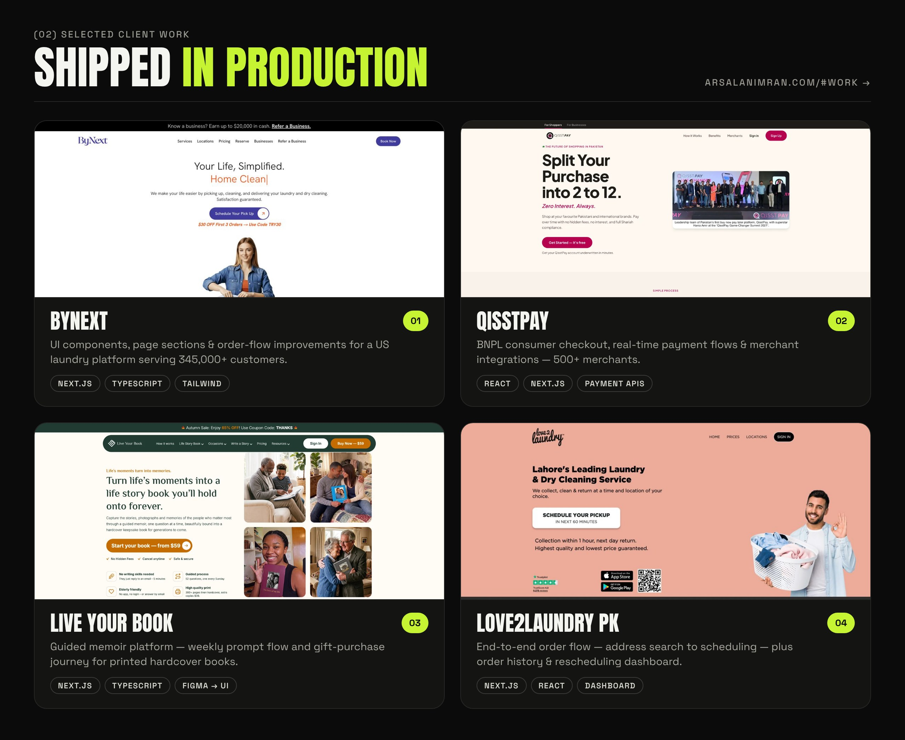

<!-- ─────────────────────────────  ARSALAN IMRAN  ───────────────────────────── -->

<a href="https://arsalanimran.com">
  
</a>

<div align="center">

<a href="https://arsalanimran.com">
  
</a>

<br/>

<a href="https://arsalanimran.com"></a>
<a href="https://www.linkedin.com/in/arsalanit007/"></a>
<a href="mailto:arsalandev007@gmail.com"></a>
<a href="https://arsalanimran.com/ArsalanImran.pdf"></a>
<br/>


</div>

---

### `(01)` &nbsp;$ whoami

```ts
const arsalan = {
  role:      "Software Engineer, Full-Stack",
  based:     "Karachi, PK · GMT+5 · overlaps UK & US hours",
  stack:     ["TypeScript", "React", "Next.js", "Node.js", "Tailwind CSS", "MongoDB", "MySQL"],
  shipped:   ["QisstPay — BNPL checkout", "ByNext", "Live Your Book", "Love2Laundry PK"],
  impact:    { years: "3+", customers: "345,000+", merchants: "500+" },
  workflow:  "AI-assisted (Cursor · Claude · ChatGPT), strict TypeScript, PR-reviewed",
  cares:     ["Core Web Vitals", "Accessibility", "Technical SEO", "Clean components"],
  status:    "open_to_work",
  contact:   "arsalandev007@gmail.com",
} as const;
```

Software engineer with **3+ years** building production web applications. Shipped consumer checkout, real-time payment flows and merchant integrations for **QisstPay** — Pakistan's first SECP-licensed Buy Now, Pay Later platform — and booking, scheduling and gift-purchase platforms for US and UK clients at **Brandigo**.

---

### `(02)` &nbsp;Selected work

<a href="https://arsalanimran.com/#work">
  
</a>

| # | Project | What I built | Live |
|:-:|---|---|:-:|
| 01 | **ByNext** | UI components, page sections & order-flow improvements — US laundry platform, 345,000+ customers | [bynext.co](https://bynext.co) |
| 02 | **QisstPay** | BNPL consumer checkout (2–12 installments), real-time payments, merchant integrations, admin dashboards | [qisstpay.com](https://qisstpay.com) |
| 03 | **Live Your Book** | Weekly prompt flow & gift-purchase journey for a guided memoir platform | [liveyourbook.com](https://liveyourbook.com) |
| 04 | **Love2Laundry PK** | End-to-end order flow — address search to scheduling — plus order history & rescheduling | [love2laundry.pk](https://love2laundry.pk) |

<sub>Side projects: <a href="https://github.com/Arsalanimran007/reflct">Reflct</a> · <a href="https://github.com/Arsalanimran007/ai-seo-saas-page">AI SEO</a> · <a href="https://github.com/Arsalanimran007/saas-landing-design">SaaS landing</a></sub>

---

### `(03)` &nbsp;Toolkit

<p>
  <br/>
  
</p>

`Next.js App Router` `SSR / SSG` `TanStack Query` `Redux Toolkit` `shadcn/ui` `Radix UI` `Framer Motion` `REST APIs` `Payment APIs` `GTM` `Meta Pixel / CAPI` `Core Web Vitals` `Technical SEO` `WCAG` `Cursor` `Claude` `ChatGPT` `Agile / Scrum`

---

### `(04)` &nbsp;Experience

```diff
+ Full-Stack Developer · Brandigo (UK digital agency) · On-site, Karachi      Sep 2025 – Sep 2026
    ByNext · Live Your Book · Love2Laundry PK — booking, scheduling & gift-purchase platforms

+ Frontend Developer · QisstPay (BNPL, 500+ merchants) · Karachi              Dec 2022 – Jun 2025
    Consumer checkout · real-time payment flows · merchant integrations · admin dashboards
```

### `(05)` &nbsp;How I work

| `01` Plan & scaffold | `02` Build & review | `03` Ship & measure |
|---|---|---|
| Component architecture, typed API contracts, AI-assisted scaffolding | Strict TypeScript, reusable components, PR review before every merge | Lighthouse audits, accessibility, SEO metadata & analytics on every release |

---

<div align="center">


</div>

---

<div align="center">

**Hiring for React / Next.js / full-stack?** &nbsp;→&nbsp; [arsalandev007@gmail.com](mailto:arsalandev007@gmail.com) · [arsalanimran.com](https://arsalanimran.com)

<sub>Karachi, Pakistan · Remote & hybrid · Overlaps UK & US working hours</sub>

</div>
