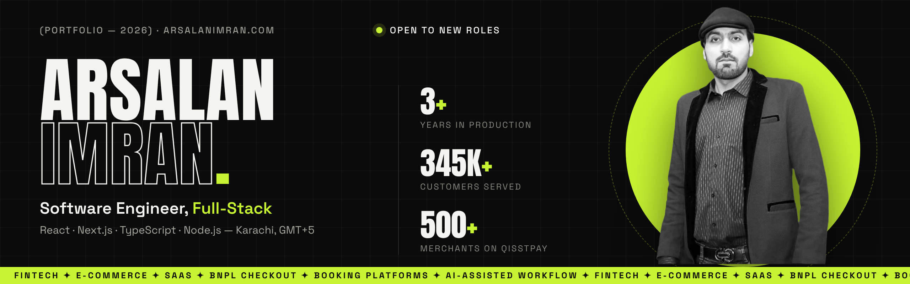
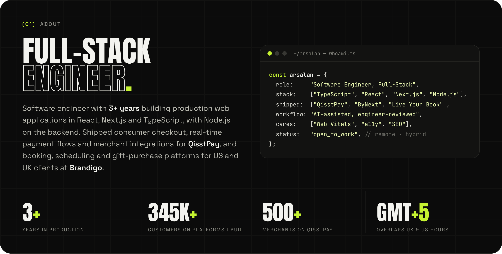
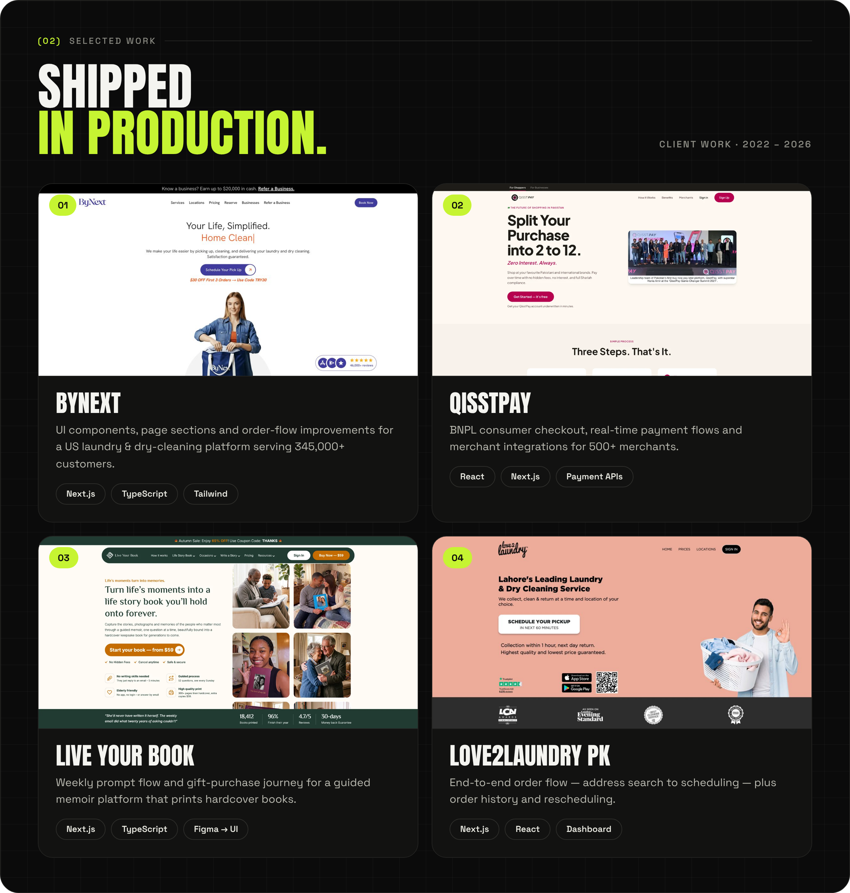
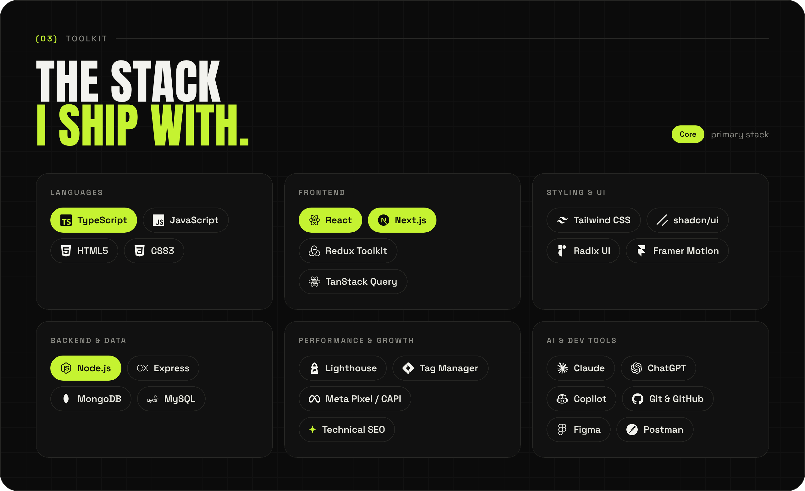
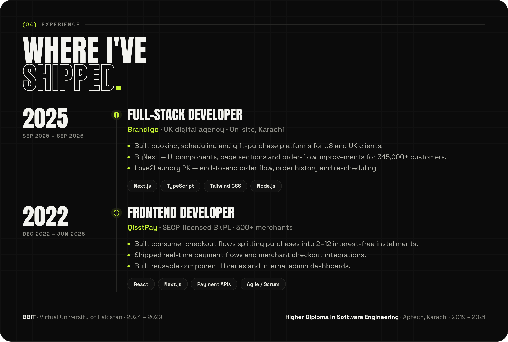
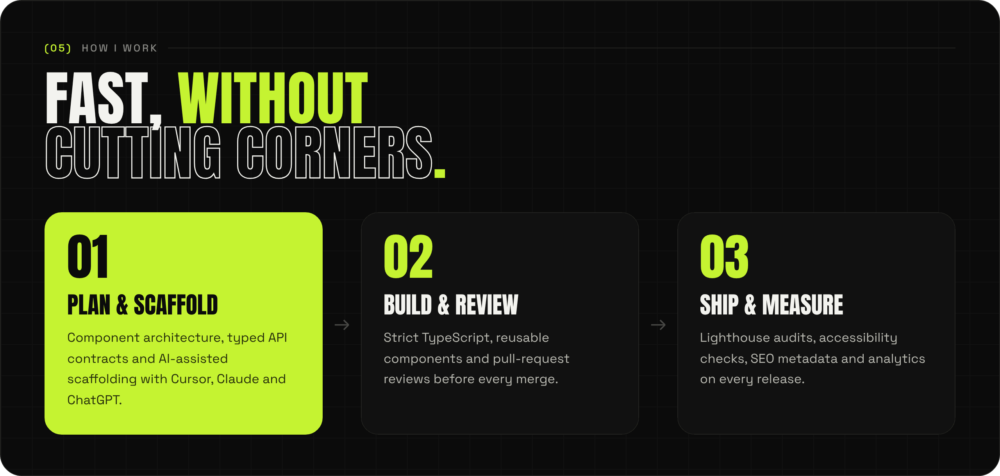
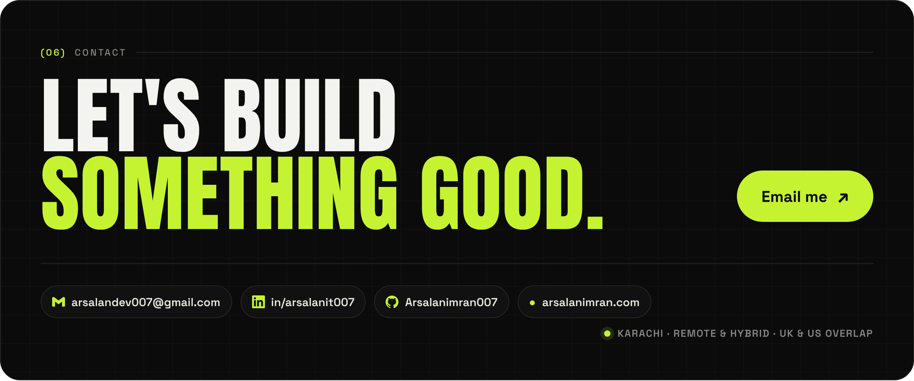

 

  

  <a href="https://bynext.co">bynext.co</a> &nbsp;·&nbsp;
  <a href="https://qisstpay.com">qisstpay.com</a> &nbsp;·&nbsp;
  <a href="https://liveyourbook.com">liveyourbook.com</a> &nbsp;·&nbsp;
  <a href="https://love2laundry.pk">love2laundry.pk</a>
   
  Side projects: <a href="https://github.com/Arsalanimran007/reflct">Reflct</a> · <a href="https://github.com/Arsalanimran007/ai-seo-saas-page">AI SEO</a> · <a href="https://github.com/Arsalanimran007/saas-landing-design">SaaS landing</a>

  

  

  

